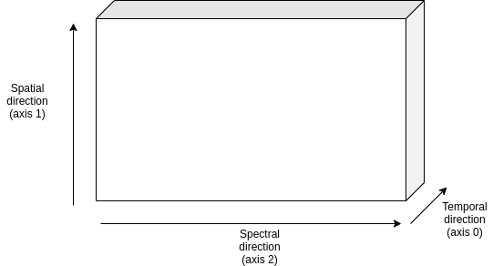
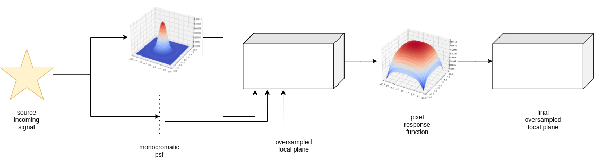
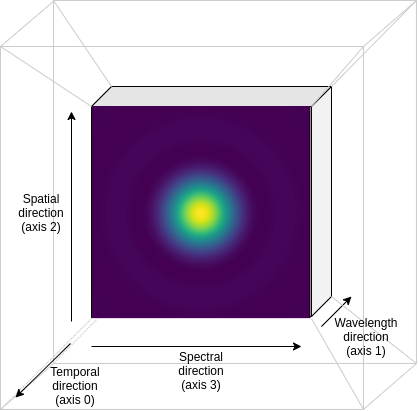
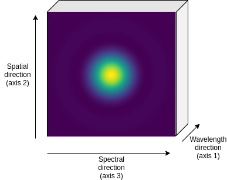
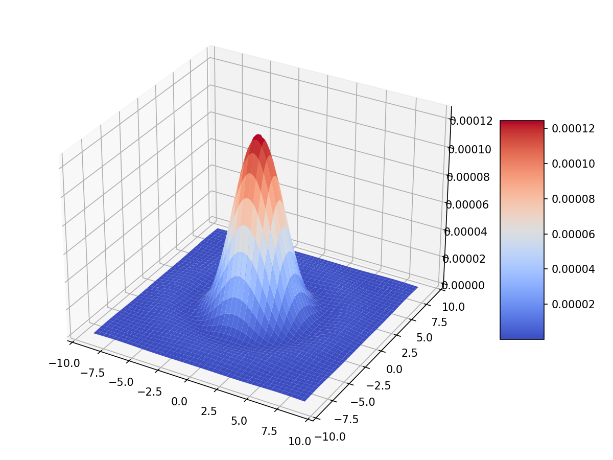
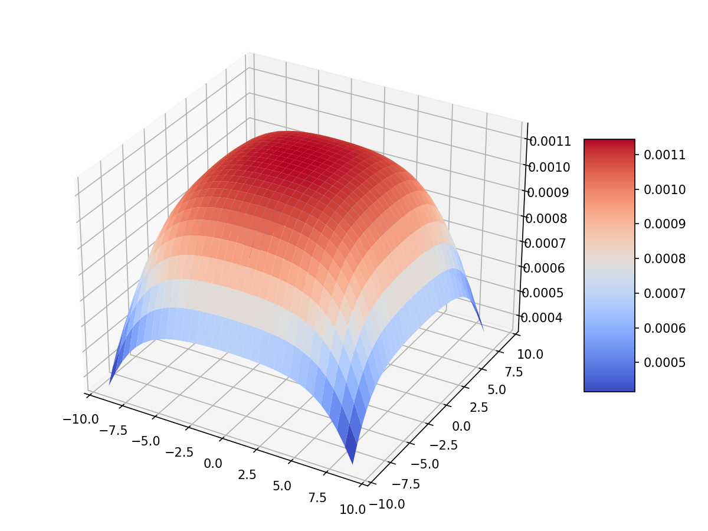

===========
Focal plane
===========

Create the focal planes
-----------------------

The next step in the :class:`~exosim.models.channel.Channel` pipeline is to
create an empty focal plane to populate, with
:func:`~exosim.models.channel.Channel.create_focal_planes`:

.. code-block:: python

        channel.create_focal_planes()

This calls the
:class:`~exosim.tasks.instrument.create_focal_plane.CreateFocalPlane` task,
which first builds the focal-plane array with
:class:`~exosim.tasks.instrument.create_focal_plane_array.CreateFocalPlaneArray`.

.. _detector geometry:

Detector geometry
^^^^^^^^^^^^^^^^^

The first input is the detector geometry, given in the channel detector
description:

.. code-block:: xml

    <channel> channel_name

        <detector>
            <delta_pix unit="micron"> 18.0 </delta_pix>
            <spatial_pix>64</spatial_pix>
            <spectral_pix>364</spectral_pix>
            <oversampling>3</oversampling>
        </detector>

    </channel>

This builds a detector with 64 pixels in the spatial direction and 364 pixels in
the dispersion direction, each 18 micron wide. The `oversampling` key adds
sub-pixels: here each pixel is split into 3 in each direction, giving 9
sub-pixels.

.. note::
    The oversampling factor has two jobs. The first is the pixel integral: a
    pixel collects the light that falls on its whole area, not the value of the
    PSF at its centre. `ExoSim` evaluates the PSF on the sub-pixels and then sums
    them over a pixel-sized box with the intra-pixel response function (see
    :ref:`irf`). With an oversampling of 1 there is nothing to sum: each pixel
    holds the PSF sampled at its centre, and for an undersampled PSF
    (:math:`F\lambda` comparable with the pixel) the brightest pixel is
    overestimated by tens of per cent: 44% for FGS1 on the Ariel payload.
    The second job is the pointing jitter (see :ref:`Instantaneous readout`),
    which moves the PSF by fractions of a pixel.

    The result converges as the factor grows. For the Ariel channels an
    oversampling of 3 gives the brightest pixel within about 2% of an
    oversampling of 5. Odd factors are preferred: the centre of a physical pixel
    then falls on a sub-pixel centre, sub-pixel ``osf * m + osf // 2`` for pixel
    ``m``, which is where every reader takes the physical pixels from.

Wavelength solution
^^^^^^^^^^^^^^^^^^^

For a `spectrometer` channel, the wavelength solution gives the wavelength
collected by each pixel in the dispersion direction. It is specified as:

.. code-block:: xml

    <channel> channel_name
        <wl_solution>
            <wl_solution_task>LoadWavelengthSolution</wl_solution_task>
            <datafile>__ConfigPath__/wl_sol.ecsv</datafile>
            
auto

        </wl_solution>
    </channel>

The `wl_sol.ecsv` file is a table with three columns, `Wavelength`, `x` and `y`,
where `x` is the dispersion direction and `y` is the spatial direction. If `y`
is 0 at every wavelength, the source light is dispersed only along the
dispersion direction; otherwise it is also dispersed spatially. The wavelengths
assigned to each pixel are stored on the focal plane, in the `spectral` and
`spatial` attributes of the :class:`~exosim.models.signal.Signal`.

`wl_solution_task` names the task that loads the wavelength solution; the default
is
:class:`~exosim.tasks.instrument.load_wavelength_solution.LoadWavelengthSolution`,
which can be customised (see :ref:`Custom Tasks`).

The **center** key sets the central pixel in the spectral direction:

- `auto` puts the central wavelength of the channel at the centre of the pixel
  array;
- a wavelength value centres the wavelength solution on that wavelength;
- an integer shifts the pixel array by that many pixels.

The sub-pixel coordinates are anchored so that the centre sub-pixel of each
physical pixel sits where that pixel would be without oversampling: the
wavelength assigned to a physical pixel does not depend on the oversampling
factor.

A `photometer` channel needs no wavelength solution. The
:class:`~exosim.tasks.instrument.create_focal_plane_array.CreateFocalPlaneArray`
task uses the detector responsivity to derive a wavelength solution for the next
step (:ref:`rescale contribution`).

Source and foreground focal planes
----------------------------------

Once the array is built, the
:class:`~exosim.tasks.instrument.create_focal_plane.CreateFocalPlane` task
stacks copies of it along the temporal axis.

Finally, :func:`~exosim.models.channel.Channel.create_focal_planes` duplicates
the stack to create a focal plane for the foreground contributions. This
populates the `focal_plane` and `frg_focal_plane` attributes of
:class:`~exosim.models.channel.Channel`.

.. _rescale contribution:

Rescale contributions
---------------------

With the focal-plane size and the wavelength solutions known, the incoming
signals can be rescaled from signal densities (:math:`counts/s/\mu m`) to proper
signals (:math:`counts/s/pixel`):

.. code-block:: python

        channel.rescale_contributions()

:func:`~exosim.models.channel.Channel.rescale_contributions` updates the
`sources` and `path` keys of :class:`~exosim.models.channel.Channel` by rebinning
the signals onto the focal-plane dispersion binning. It then estimates the
wavelength-solution gradient from the pixel wavelength solution and multiplies
the signal by it. For a `photometer` the wavelength axis includes both ends of the
band, so the two end samples are weighted by half a step (trapezoid rule) and the
weights sum to the band width; earlier versions gave them a full step, which
widened the band by one step (about 3% at an oversampling of 1).

The method is the sum of two halves that can also be called on their own:
:func:`~exosim.models.channel.Channel.rescale_sources` for the sources and
:func:`~exosim.models.channel.Channel.rescale_radiances` for the path radiances
(foregrounds and optical-element emission). Each contribution must be rescaled
exactly once. A pipeline that propagates the sources a second time, for example
after :func:`~exosim.models.channel.Channel.define_sources`, should call
:func:`~exosim.models.channel.Channel.rescale_sources` only: calling
:func:`~exosim.models.channel.Channel.rescale_contributions` again would multiply
the radiances by the wavelength step a second time.

Populate the focal plane
------------------------

Next, populate the source focal plane, following this scheme:

First, produce a monochromatic PSF for each wavelength sampled in the pixel
wavelength solution. Then multiply each PSF by the source signal at its
wavelength and add the result to the relevant pixel. Finally, apply the
intra-pixel response function (IRF) to the populated focal plane.

Until the IRF is applied, the sub-pixels hold samples of the light distribution,
not pixel signals: it is the IRF that sums them into the signal a pixel collects
(:ref:`irf`). For a `photometer` the PSF is centred on the centre sub-pixel of
physical pixel ``N // 2`` in both directions (``N`` physical pixels per axis);
for a `spectrometer` without a spatial wavelength solution, on the centre
sub-pixel of pixel ``N // 2`` in the spatial direction. That is the pixel the
apertures are centred on: the aperture tools put the centre at ``N / 2`` in the
:mod:`photutils` convention, where the centre of pixel ``i`` has coordinate ``i``.
The physical position of the source is the same for any oversampling factor.

The first steps are handled by:

.. code-block:: python

        channel.populate_focal_plane()

:func:`~exosim.models.channel.Channel.populate_focal_plane` calls the
:class:`~exosim.tasks.instrument.populate_focal_plane.PopulateFocalPlane` task.

PSF
^^^

The first step is building the point-spread-function hypercube.

For each temporal step, the PSF cube is defined as in the figure below:

The PSF is specified in the `psf` section of the `.xml` channel description. The
simplest PSFs are the `Airy` and `Gauss` functions:

.. code-block:: xml

    <channel> channel_name
        <psf>
            <shape>Airy</shape>
        </psf>
    </channel>

In this case the
:class:`~exosim.tasks.instrument.populate_focal_plane.PopulateFocalPlane` task
calls :func:`~exosim.utils.psf.create_psf`, which produces a PSF cube like the
one above:

The `psf` section accepts these extra keys:

.. code-block:: xml

    <channel> channel_name
        <psf>
            <shape>Airy</shape>
            <nzero> 8 </nzero>
            <size_y> 64 </size_y>
            <size_x> 64 </size_x>
        </psf>
    </channel>

`size_x` and `size_y` are the sizes of the PSF cube, in sub-pixels, in the
spectral and spatial directions. They can also be set to `full` to use the full
size of the focal plane. `nzero` is the number of dark rings of the Airy
pattern that the window reaches: the half width of the window is the radius of
the `nzero`-th dark ring, :math:`j_{1,n} F\lambda/\pi`, computed at the longest
wavelength of the channel. The first dark ring is at :math:`1.22 F\lambda`,
the fourth at :math:`4.24 F\lambda`. The Gaussian PSF uses the same window.

If you give neither `nzero` nor `size_x` and `size_y`, the window is a square
whose side is the shorter side of the oversampled focal plane (made odd, so
that it is centred on the PSF, and never larger than the focal plane). This is
the same rule that :class:`~exosim.tasks.instrument.loadPsfPaos.LoadPsfPaos`
uses, and it means that the window does not cut any light that could reach the
detector. If you give `size_x` and `size_y`, or `nzero`, your choice is used as
it is.

The PSF is computed only inside this window, so the light that falls outside it
is not simulated. Each PSF is normalised to the *total* energy of the
analytic profile: the cube sums to the fraction of the energy inside the window,
a number smaller than one, and the missing light is lost rather than added back
to the core. With the default window the light that is lost is the light that
falls outside the detector square, and it is lost because it misses the
detector. With an explicit `nzero` or size, the window may be smaller than the
detector, and then the light between the window and the edge of the detector is
lost as well, even though it would have landed on a pixel. The fraction is
computed from the profile itself, not from the samples, so it is the same for
any oversampling factor. `ExoSim` logs the fraction left out for each channel
and warns above 1%. Raise `nzero` to keep more of the wings, at the cost of a
larger PSF cube. Earlier versions normalised each PSF to unit sum inside the
window, which put the truncated wings back into the core, and they used a window
half as wide as the one described here, so that `nzero = 4` reached only :math:`2.1 F\lambda`, just short of the
second dark ring.

You may instead want to load specific PSF shapes. Do this with a dedicated
:class:`~exosim.tasks.instrument.loadPsf.LoadPsf` task, which produces a
hypercube where each temporal step of the focal plane has its own PSF cube. The
native PSF format supported by `ExoSim` is the PAOS format, handled by
:class:`~exosim.tasks.instrument.loadPsfPaos.LoadPsfPaos`. Specify it as:

.. code-block:: xml

    <channel> channel_name
        <psf>
            <psf_task>LoadPsfPaos</psf_task>
            <filename>__ConfigPath__/paos_file.h5</filename>
        </psf>
    </channel>

:class:`~exosim.tasks.instrument.loadPsfPaos.LoadPsfPaos` loads the PSF cube from
`filename`. Each PAOS sample is treated as the energy of its own cell, and the
cells are rebinned onto the focal-plane sub-pixels by their overlap, so that every
sub-pixel holds the energy that falls on it. This conserves the PAOS energy
exactly for any oversampling factor, including the transmission losses already
contained in the PAOS volume, and the energy that falls outside the window is
not put back. The PAOS centre, where the PAOS PSF has its peak, is placed on the
centre sub-pixel of the window, the same position used for the analytic PSFs.
The PSFs are then interpolated onto a wavelength grid matching the focal plane,
producing the cube; this speeds up the later `ExoSim` steps. The default
:class:`~exosim.tasks.instrument.loadPsfPaos.LoadPsfPaos` task has no time
dependence, so the PSF cube is repeated along the temporal axis.

Wavelengths outside the PAOS range
""""""""""""""""""""""""""""""""""

A PAOS file gives the PSF at a few wavelengths only, while the wavelength axis of
a channel can reach well beyond them. A photometer is the usual case: its
efficiency can have a small red leak, so that light between, say, 0.7 and 2 um
reaches the detector although the PAOS PSFs stop at 0.7 um.

Between the PAOS wavelengths the images are interpolated linearly. Outside them,
the PSF of the nearest PAOS wavelength :math:`\lambda_e` is scaled in size in
proportion to the wavelength, with :math:`s = \lambda / \lambda_e`:

.. math::

    \mathrm{PSF}_\lambda(x, y) = \mathrm{PSF}_e(x / s,\, y / s) / s^2 .

The scaling is about the PSF centre and it conserves the energy of the image.
The energy that the stretching pushes outside the window is lost, as is the
energy of the PAOS PSF that falls outside the window. The size of a diffraction
pattern is proportional to :math:`\lambda F`, so the scaling is exact for the
diffraction part of the PSF. We scale the images, instead of extrapolating them
linearly, because a linear extrapolation far from the PAOS wavelengths produces
images with more negative than positive energy, which are not PSFs.

This is an approximation. The aberration pattern of the edge wavelength is kept
as it is, while the wavefront error, measured in waves, decreases as
:math:`1/\lambda`: at longer wavelengths the real PSF is closer to the diffraction
limit than the scaled one. When the band of a channel extends beyond the PAOS
wavelengths, it is better to produce a PAOS file that covers the whole band.

.. note::
    For a long observation with a small low-frequency variation, keeping the
    repeated PAOS PSF in memory can be expensive. You can store a single PSF by
    setting `time_dependence` to False in the `psf` section:

    .. code-block:: xml

        <channel> channel_name
            <psf>
                <psf_task>LoadPsfPaos</psf_task>
                <filename>__ConfigPath__/paos_file.h5</filename>
                 <time_dependence>False</time_dependence>
            </psf>
        </channel>

To add a time dependence, use a custom
:class:`~exosim.tasks.instrument.loadPsf.LoadPsf` task. An example with PAOS PSFs
is
:class:`~exosim.tasks.instrument.loadPsfPaosTimeInterp.LoadPsfPaosTimeInterp`.

Finally, the PSFs are stored in the output file.

Adding the PSF to the focal plane
^^^^^^^^^^^^^^^^^^^^^^^^^^^^^^^^^^

Once the PSF cube is ready, for each temporal step of the focal plane a
monochromatic PSF is added to the relevant pixel, multiplied by the intensity of
the source signal at the same temporal step. This produces a dispersed image for
a `spectrometer` or an accumulated PSF for a `photometer`. Because the focal
plane and the source signal share the same temporal steps, any time variation in
the source signal is carried through to the focal-plane image. The result is an
oversampled focal plane.

.. _irf:

Intra-pixel response function
-----------------------------

A pixel does not respond uniformly across its surface. The charge produced by a
photon diffuses before it is collected, so a photon that lands near the centre
of a pixel is almost always counted there, while one that lands near the edge is
shared with the neighbour. `ExoSim` represents this with the intra-pixel
response function (IRF): for each sub-pixel offset, the probability that the
charge of a photon landing there is collected by the pixel. Applying it is also
what turns the sampled light distribution into pixel signals, because the IRF is
a sum over a pixel-sized box. It is applied by
:func:`~exosim.models.channel.Channel.apply_irf`:

.. code-block:: python

        channel.apply_irf()

which convolves the source focal plane and the background focal plane, if any.
:func:`~exosim.models.channel.Channel.apply_irf_to` applies the same kernel to
any other focal plane of the channel; the kernel is built and written to the
output once per channel.

After the convolution every sub-pixel holds the signal that a pixel centred on it
would collect. The physical pixels are then read on the centre sub-pixels,
``osf * m + osf // 2`` for pixel ``m``: this is what the radiometric readers, the
saturation estimate and the sub-exposures do.

Create the IRF
^^^^^^^^^^^^^^

The task that estimates the IRF is named as:

.. code-block:: xml

    <channel> channel_name
        <detector>
            <irf_task>CreateIntrapixelResponseFunction</irf_task>
        </detector>
    </channel>

The default class is
:class:`~exosim.tasks.instrument.create_intrapixel_response_function.CreateIntrapixelResponseFunction`.
It implements the equation of Barron et al., PASP, 119, 466–475, 2007
(https://doi.org/10.1086/517620), and needs the pixel `diffusion length` and the
`intra-pixel distance`:

.. code-block:: xml

    <channel> channel_name
        <detector>
            <irf_task>CreateIntrapixelResponseFunction</irf_task>
            <diffusion_length unit="micron">1.7</diffusion_length>
            <intra_pix_distance unit="micron">0.0</intra_pix_distance>
        </detector>
    </channel>

With diffusion the collection probability is smooth at the pixel edges (about
0.5 on the edge itself) and has tails over the neighbouring pixels: for 18 micron
pixels and a 1.7 micron diffusion length, about 11% of the response along each
axis lies outside the pixel. The kernel therefore extends over as many
neighbouring pixels as needed for the tails to become negligible, and the
inter-pixel gaps (`intra_pix_distance`) are removed around every pixel boundary.
The kernel is normalised so that its elements sum to
:math:`\mathrm{osf}^2`: a uniform illumination stays uniform, and each pixel
collects the total charge it receives. Without diffusion the kernel is a plain
box as wide as one pixel.

.. caution::
    Earlier versions sampled the response only inside the pixel and renormalised
    it: the charge that should diffuse into the neighbours was put back into the
    pixel, which overestimated the brightest pixel of a centred source (by up to
    20% for an undersampled Airy) instead of reducing it. Results with
    ``diffusion_length = 0`` are unchanged.

One alternative default task is available,
:class:`~exosim.tasks.instrument.create_oversampled_intrapixel_response_function.CreateOversampledIntrapixelResponseFunction`.
It produces an oversampled version of the IRF, zero-padded to the size of the
PSF, for use with the `fast_convolution` method.

You can also supply your own task and parameters. Note that the IRF kernel is
expected to sum to :math:`\mathrm{osf}^2`, the number of sub-pixels in a pixel,
so that the convolution conserves the flux per pixel. Here is an example IRF:

.. caution::
    The `irf_task` key is optional. If it is missing, whenever the oversampling
    is larger than 1, :func:`~exosim.models.channel.Channel.apply_irf` uses the
    default
    :class:`~exosim.tasks.instrument.create_intrapixel_response_function.CreateIntrapixelResponseFunction`
    task and the configured oversampling is kept. With no `diffusion_length`
    that task gives a top-hat over the pixel (a kernel of
    :math:`\mathrm{osf} \times \mathrm{osf}` equal values), which is the
    least a pixel does: it integrates the light over its area. Earlier versions
    ignored the oversampling when `irf_task` was missing, and sampled the PSF at
    the pixel centres.

Apply the IRF
^^^^^^^^^^^^^

Once the pixel response function is ready, it is applied with
:class:`~exosim.tasks.instrument.apply_intra_pixel_response_function.ApplyIntraPixelResponseFunction`,
which convolves the focal plane with the IRF.

The source focal plane is now complete.

.. note::

    In the default recipe (:ref:`focal plane recipe`) the IRF step runs for every
    channel with an oversampling larger than 1, whether or not an `irf_task` key
    is given in the channel description. Without the key the default task is
    used, because without the IRF the sub-pixels would hold samples of the PSF,
    not pixel signals.

You can choose the convolution method:

.. code-block:: xml

    <channel> channel_name
        <detector>
            <convolution_method>fftconvolve</convolution_method>
        </detector>
    </channel>

The available methods are `fftconvolve` (:func:`scipy.signal.fftconvolve`),
`convolve` (:func:`scipy.signal.convolve`), `ndimage.convolve`
(:func:`scipy.ndimage.convolve`) and `fast_convolution`
(:func:`exosim.utils.convolution.fast_convolution`). The default is
`fftconvolve`.

.. note::
    The `fast_convolution` method is the one implemented in `Sarkar et al., 2021
    <https://link.springer.com/article/10.1007/s10686-020-09690-9>`__. It is
    very accurate but slower than the others and memory-hungry, so use it only
    for small oversampling factors.

The
:class:`~exosim.tasks.instrument.create_intrapixel_response_function.CreateIntrapixelResponseFunction`
task creates a kernel compatible with `fftconvolve`, `convolve` and
`ndimage.convolve`. The
:class:`~exosim.tasks.instrument.create_oversampled_intrapixel_response_function.CreateOversampledIntrapixelResponseFunction`
task instead produces a kernel for `fast_convolution`, a method developed
specifically for ExoSim.

Populate the foreground focal plane
-----------------------------------

Populate the foreground focal plane with
:func:`~exosim.models.channel.Channel.populate_foreground_focal_plane`:

.. code-block:: python

        channel.populate_foreground_focal_plane()

This uses the
:class:`~exosim.tasks.instrument.foregrounds_to_focal_plane.ForegroundsToFocalPlane`
task, which adds the foreground contributions stored in the `path` attribute to
the foreground focal plane stored in `frg_focal_plane`.

If a `path` element sits before a slit, its signal is dispersed: the
contribution is convolved with a kernel as wide as the slit (in pixels) and then
added to the full array. If the slit width at the focal plane is :math:`L`
pixels and the spectral resolving power at some :math:`\lambda_0` is
:math:`R(\lambda_0)`, the detector receives diffuse radiation over the
wavelength range
:math:`\left( \lambda_j - \frac{L \lambda_0}{4 R(\lambda_0)} \, , \, \lambda_j  + \frac{L \lambda_0}{4 R(\lambda_0)} \right)`,
not over the full range passed by the filter. So the :math:`j`-th pixel,
sampling wavelength :math:`\lambda_j`, collects

.. math::
    S(j) = \int_{\lambda_j - \frac{L \lambda_0}{4 R(\lambda_0)}}^{\lambda_j  + \frac{L \lambda_0}{4 R(\lambda_0)}} S_{for} (\lambda) d \lambda

If a `path` element sits after a slit, or there is no slit in the path, the
signal integrated over the full wavelength range is simply added to each pixel:

.. math::
    S = \int S_{for} (\lambda) d \lambda

The foreground focal plane is now complete.

.. _sub focal planes:

Foreground sub focal planes
^^^^^^^^^^^^^^^^^^^^^^^^^^^^

If at least one optical element is marked with

.. code-block:: xml

    <optical_path>
        <opticalElement>
            ...
            <isolate> True </isolate>
        </opticalElement>
    </optical_path>

then the sub-focal planes are computed. The same
:func:`~exosim.models.channel.Channel.populate_foreground_focal_plane` method
also populates a `frg_sub_focal_planes` attribute: a dictionary of all the
foreground signal contributions, singling out the ones marked
``isolate=True``. The sum of all the sub-focal planes equals `frg_focal_plane`.

This mode lets you study the effect of a single optical surface.
