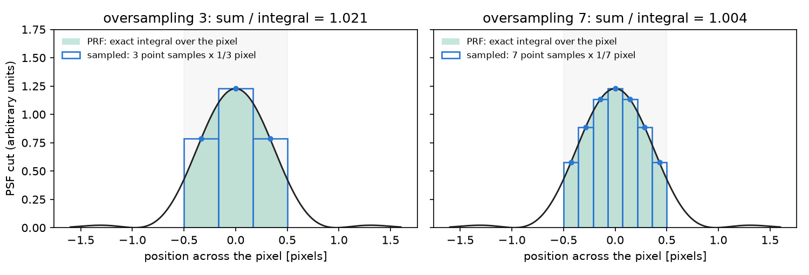
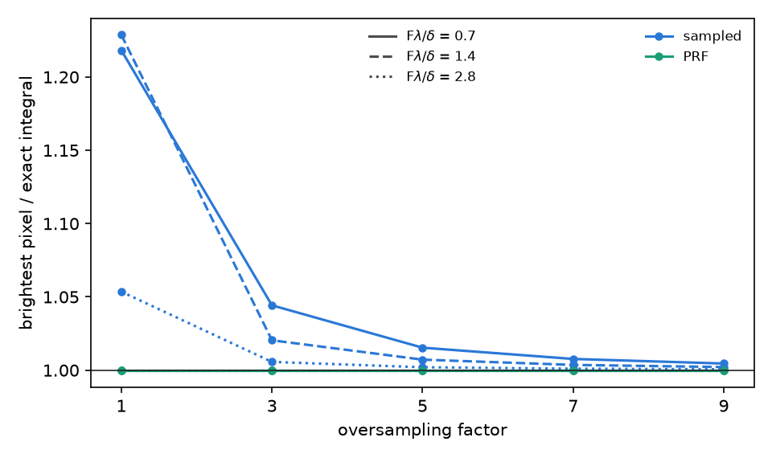
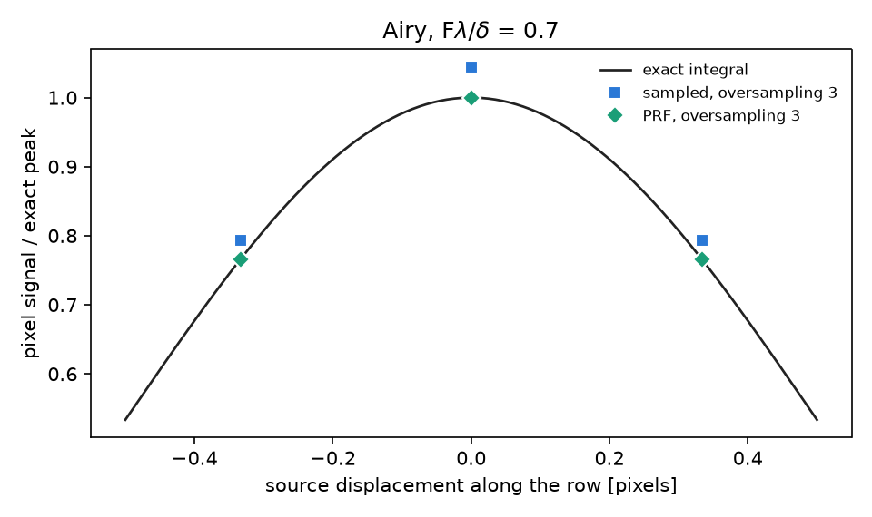

.. _sampled vs prf:

==============================
Sampled and PRF populations
==============================

`ExoSim` can fill the focal plane in two ways. The *PRF* population, the default,
computes the light that each pixel collects as an exact integral of the PSF over
the pixel. The *sampled* population, the scheme of earlier versions, samples the
PSF on the sub-pixel grid and then sums the samples with the intra-pixel response
function (IRF). This page explains what the two do, shows with a simple example
where they differ, and says when you still need the sampled one.

The example is generic, not tied to any instrument: a monochromatic Airy PSF at
1 µm, on a detector of 24 × 24 pixels of 18 µm, without diffusion, with the
source on the centre of pixel ``N // 2`` as for a photometer. The figures are made
with the `ExoSim` tasks themselves
(:class:`~exosim.tasks.instrument.populate_focal_plane.PopulateFocalPlane` with
the IRF, and
:class:`~exosim.tasks.instrument.populate_focal_plane_prf.PopulateFocalPlanePrf`),
and compared with a third estimate that uses neither: the Airy integrated over the
pixel by brute force, on cells of 1/41 of a pixel. The script is
``examples/plot_sampled_vs_prf.py``.

The size of the PSF in pixels is what matters, and it is measured by
:math:`F\lambda/\delta`, the f-number times the wavelength over the pixel size:
the first dark ring of the Airy has a radius of :math:`1.22\,F\lambda/\delta`
pixels. We use three values: 0.7 (a strongly undersampled PSF, most of the light
in one pixel), 1.4 and 2.8 (a PSF spread over several pixels).

What a pixel measures
---------------------

A pixel does not measure the PSF at its centre. It collects all the light that
falls on its area, weighted by the probability that a photon absorbed at a given
point is counted in that pixel. This is the pixel response function, the PSF
integrated over the pixel response :math:`P`:

.. math::
    \mathrm{PRF}_\lambda(\Delta x, \Delta y) = \iint \mathrm{PSF}_\lambda(x, y)\,
    P(x - \Delta x)\, P(y - \Delta y)\, \mathrm{d}x\, \mathrm{d}y

where :math:`(\Delta x, \Delta y)` is the position of the pixel centre with
respect to the source. Without diffusion :math:`P` is 1 inside the pixel and 0
outside; with diffusion and inter-pixel gaps it is the collection probability
described in :ref:`irf`.

The sampled population approximates this integral with a sum. With an
oversampling factor :math:`n`, each pixel is divided into :math:`n \times n`
sub-pixels; the PSF is evaluated at the centre of each one, and the IRF adds the
:math:`n^2` values, each weighted by the area of a sub-pixel. It is the midpoint
rule of numerical integration. The PRF population computes the integral itself,
once, on a fine table, and reads it at the position of every pixel.

The figure shows a cut through the centre of the PSF, for
:math:`F\lambda/\delta = 0.8`, across one pixel. The shaded area is the integral
the pixel measures; the boxes are the sum of the sampled population.

Near its peak the PSF is concave, and there the midpoint rule always
overestimates: each sample is taken where the curve is higher than its average
over the sub-pixel. With 3 samples the cut is 2.1% too high, with 7 samples
0.4%. On the focal plane the error enters along both axes, so it is roughly
twice as large as on the cut.

The brightest pixel
-------------------

The brightest pixel decides when a detector saturates, and so the longest
exposure it can take. This is where the two populations differ most. The figure
shows the brightest pixel of the example, divided by the exact integral, for
oversampling factors from 1 to 9.

The sampled population converges to the exact value from above, and slowly for
an undersampled PSF. At :math:`F\lambda/\delta = 0.7` the brightest pixel is 22%
too high at an oversampling of 1, where the sampled population takes the PSF at
the pixel centre times the pixel area; 4.4% at 3, 1.5% at 5 and 0.8% at 7. A wider
PSF is less curved over one pixel and converges faster: at
:math:`F\lambda/\delta = 2.8` the error is 0.6% at an oversampling of 3.

The PRF gives the exact value within 0.03% at any oversampling factor, 1
included. The physical pixels do not depend on the oversampling factor, so you
choose it for what it still controls: the jitter, which moves the focal plane by
whole sub-pixels (see the next section).

The total signal is not affected in the same way. Over the whole PSF the errors
of the midpoint rule largely cancel, because the wings are convex and there the
samples fall below the average. In the example, at an oversampling of 3, the light
of the pixels within 3 pixels of the source is only 0.04% higher than the exact
value with the sampled population, for both :math:`F\lambda/\delta = 0.7` and 1.4,
while its brightest pixel is 4.4% and 2.0% high. The population matters most for saturation, frame time and any
result that depends on the signal of single pixels.

Moving the source by a fraction of a pixel
-------------------------------------------

An oversampled focal plane is used to move the source by a fraction of a pixel.
Reading the plane at sub-pixel ``osf * m + osf // 2 + k`` instead of
``osf * m + osf // 2`` gives pixel ``m`` with its centre shifted by ``k / osf``
pixels, that is, the source displaced by ``-k / osf``. This is how the jitter of
the sub-exposures is simulated (:ref:`Instantaneous readout`). It is correct only
if every sub-pixel holds the signal of a whole pixel centred on it.

The figure shows, for :math:`F\lambda/\delta = 0.7` and an oversampling of 3, the
signal of the central pixel read at the three sub-pixel phases, against the exact
signal for a source displaced continuously across the pixel.

The PRF lies on the exact curve at every phase, within 0.03% of the peak. The
sampled population is above it at every phase, by up to 4.4% of the peak, for the
reason seen above. A jittered observation built from the sampled plane therefore
inherits the error of the brightest pixel, and it can change from one phase to the
next.

The position of the source also differs. With the sampled population the
pointing offset of a source is rounded to a whole sub-pixel; with the PRF it is
used as it is (:ref:`pointing`).

Spectra
-------

In a spectrometer the difference reaches also the wavelength axis. The sampled
population resamples the source spectrum on the sub-columns, so that each
sub-column carries a single wavelength, and it places one monochromatic PSF per
sub-column. The PRF keeps the source spectrum on its own wavelength grid, and each
sample deposits its light at the exact position given by the wavelength
solution. The sampled spectrum therefore also depends on the oversampling
factor along the dispersion, and the PRF does not.

What the PRF approximates
-------------------------

The PRF is exact only within the resolution of its tables. The integral is
tabulated on a grid of ``prf_sampling`` offsets per pixel (10 by default), at a
set of wavelength nodes (``prf_nodes`` for an analytic PSF, the PAOS wavelengths
for PAOS PSFs), and interpolated in between. In the example above this costs
0.03% of the peak. A very undersampled PSF may need ``prf_sampling`` 20. As in the
sampled population, the analytic PSF is cut by a window, and the light outside it
is lost and reported in the log (:ref:`prf population`).

When to use the sampled population
----------------------------------

The PRF cannot yet reproduce every configuration. It needs the default IRF task,
because it builds the pixel response analytically from ``diffusion_length``,
``intra_pix_distance`` and ``delta_pix``, and it supports the analytic PSFs and
:class:`~exosim.tasks.instrument.load_psf_paos.LoadPsfPaos`, not time-dependent
PSFs
(:class:`~exosim.tasks.instrument.loadPsfPaosTimeInterp.LoadPsfPaosTimeInterp`)
or custom PSF tasks. In these cases select the sampled population explicitly:

.. code-block:: xml

    <channel> channel_name
        <psf>
            <population>sampled</population>
        </psf>
    </channel>

If the ``population`` key is not given and the configuration is one of these,
`ExoSim` uses the sampled population and logs a warning that says why. If
``<population>prf</population>`` is given explicitly on such a configuration, it
raises an error instead.

The sampled population also reproduces the focal planes of earlier `ExoSim`
versions, where it was the only one. With it, use an oversampling factor large
enough for your PSF: the figure of the brightest pixel above tells you the error
to expect.
